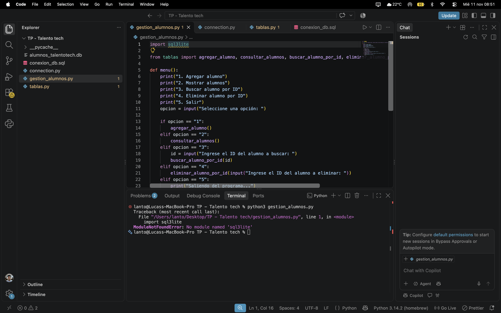

Hola a todos!

Este proyecto pretende demostrar lo que pude aprender en el curso de 
TalentoTech 2026. Para esta ocasion generamos un sistema de alumnos
donde se permiten ingresar, consultar y eliminar con base de datos y 
python usuarios.

El programa utiliza sqlite3, un modelo de base de datos mas compacto
que permite no instalar nada para poder depender de una conexion

El programa se utiliza mediante consola. Para poder ingresar es importante contar
con un programa capaz de levantar este tipo de archivos. Recomendamos usar
VISUAL STUDIO CODE

Una vez descargado se debe abrir la carpeta desde File/Open Folder
Cuando la carpeta ya este configurada se debe acceder a la terminal desde
Terminal/New Terminal

Una vez que se esta en la terminal se debe acceder a la carpeta que estamos
usando, para eso debe usarse el comando cd e invocar la carpeta que necesitemos

Ejemplo: "cd EjemploCarpeta"

Una vez dentro de la carpeta se usara el comando Python3 seguido del nombre
del archivo: "Python3 gestion_alumnos.py"

Esto abrira la consola de comandos para usar el programa:

Una vez ahi podemos desplazarnos mediante los numeros para acceder a los 
comandos del programa.

Muchas gracias, Atte: Lucas Lantieri